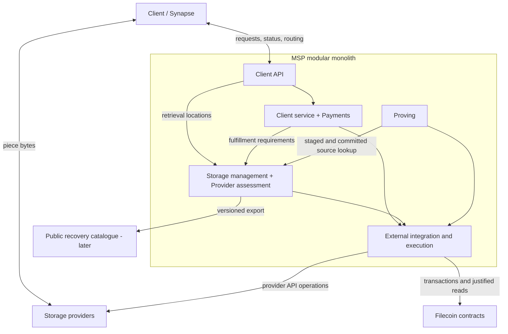

# Rhizome architecture

This document describes the MSP service's responsibilities, how its modules cooperate, and what the initial service delivers. See the [storage model](design/storage-model.md), [storage workflows](design/storage-workflows.md), [execution and integrations](design/execution-and-integrations.md), and [funding and lifecycle](design/funding-and-lifecycle.md) for the workflow contracts. The [design index](design/README.md) tracks remaining work and verification gates.

## Product objective

MSP improves the durability of the FOC offering. A client uploads data to one location and keeps the service funded. MSP verifies storage and restores protection as providers fail.

Durability depends on how many copies remain usable, how often and how closely failures coincide, and how long data stays below the protection target. Detection, scheduling, transfer, and commitment latency all contribute to that exposure. A quantitative guarantee requires explicit assumptions and targets.

## Agreed direction

- MSP is a Go modular monolith backed by PostgreSQL. Multiple instances are active at once: any instance can serve requests, and workers claim independent durable work without a system-wide leader.
- Key custody and signing audit are separate from the monolith. Transaction management retains the transaction lifecycle. Independent operation-level permission enforcement comes later.
- Clients upload to and retrieve from storage providers (SPs) directly. Repair transfers also go directly between SPs.
- Use scoped ownership for work such as a proof round or sending-account coordination. Short planning and batch-formation operations use atomic database transactions.

## Higher-level architecture

### Three cooperating responsibilities

1. **Client service and funding:** Client service handles client requests, service relationships, and termination/run-off policy. Payments handles incoming settlement and funding assessment. Together they establish which client requirements MSP is currently fulfilling.
2. **Storage fulfillment:** Storage management reconciles those requirements with existing placements and work in flight. Provider assessment supplies selection/health evidence. Planning, eager transfers, backend commitments, batching, and asynchronous removal form the central storage-maintenance loop.
3. **Client-facing proving:** Proving produces the proofs required for MSP's client-facing datasets, using storage-location information and provider witnesses. Its time-critical collection/submission workflow is distinct from placement repair.

### Major dependency paths

Transaction management, Chain access, provider HTTP adapters, and the signing interface carry out external interactions and report outcomes to the modules that requested them. Live retrieval queries Storage management's placement mapping.

### Two important ownership boundaries

- **Client requirements and backend work:** Client service determines what MSP should fulfill. Storage management decides how shared placements satisfy those requirements and reconciles backend copies asynchronously.
- **Domain decisions and external execution:** Domain modules create durable operations and interpret the results. Transaction management and adapters execute those operations. Modules own their records and expose interfaces to other modules.

PostgreSQL preserves accepted obligations and necessary results across instances. Use durable handoffs for independently owed work and retain recovery facts under the [recovery principle](engineering/principles.md#failure-must-not-create-an-unrecoverable-state).

### Working scope boundary

The initial service covers client admission, pooled PDP placement and repair, asynchronous backend removal, sampled monitoring, client-facing proving, incoming settlement and funding, direct retrieval routing, and recoverable execution across instances.

Public catalogue publication, packing, repair-in-place, and PoRep integration are later capabilities.

## Provider sets

Endorsed providers are held to stronger cooperation requirements than Approved-only providers. Select a suitable, healthy Endorsed provider as the Upload SP. An operator may explicitly authorize a capable Approved-only provider as an exception. If no eligible Upload SP is available, return a retryable admission failure.

When a provider loses endorsement but remains Approved, stop selecting it for new uploads unless it is explicitly authorized as an exception. Assess its existing placements on their own evidence; loss of endorsement alone leaves them in place.

Provider assessment tracks approval and endorsement separately from observed health. Provider-wide suspicion pauses new uploads and replica placements while checks escalate. Responsive copies remain usable for retrieval or repair. An isolated failed probe need not escalate to provider-wide suspicion; replacement at dataset or provider scope requires sufficient evidence at that scope rather than a separate failure for each piece.

## Storage terms

Client-to-MSP and MSP-to-SP deals use separate storage terms, with their own price and currency. The side making the deal chooses the `StorageTermId` and the receiving side accepts it: the client chooses its terms with MSP, and MSP chooses its terms with SPs. Client-side term IDs do not partition shared placement reuse or planning.

Terms are immutable. To change the offering, introduce new terms and disable old terms for new datasets and files. Continue serving existing datasets on disabled terms.

FWSS `352b614` supports signed dataset creation with selected terms. The inspected Synapse helper signs the legacy variant, so SDK integration must provide selected-terms signing and encoding and verify deployment compatibility.

## Acceptance and initial protection

MSP aims to maintain three PDP copies at distinct eligible SPs. An **admission** is one accepted signed AddPieces request, which can also authorize dataset creation. At acceptance, the trusted Upload SP may hold the only copy, still awaiting commitment.

MSP selects the Upload SP at tus preflight. For a new admission, validate caller authority, run exact contract preflight, and establish [parked-source evidence](design/execution-and-integrations.md#parked-source-evidence) for the signed PieceCID. MSP does not verify which upload supplied the piece. The [funding policy](design/funding-and-lifecycle.md#agreed-admission-policies) also rejects known shortfalls in backend funding or three eligible destinations. Use evidence already available for these shortfall checks; unknown backend readiness by itself permits admission. After validating authority and correlating the request, an accepted replay recovers the original operation before new-admission checks.

After acceptance, start additional transfers eagerly and proceed with client-facing and Upload-SP AddPieces independently. Either commitment can finish first, while replication continues. Batch the backend AddPieces work.

### Staging retention

Curio must provide [retention protection](design/execution-and-integrations.md#parking-refresh-and-retention) by PieceCID for a direct-upload source and by exact staging reference for a pull. Establish enough remaining retention before acceptance, then refresh source and destination staging as needed during fulfillment and recovery.

Confirm parking with a HEAD to the selected Upload SP's piece URL. Require HTTP 200 and a Content-Length equal to the expected raw size. The check transfers no body, verifies neither content nor future availability, and creates no reference or lease.

Client-facing AddPieces inclusion and backend AddPieces inclusion are independent. The SDK waits on the returned transaction hash and succeeds at successful client-facing inclusion; backend placement completes at successful backend inclusion. Neither requires additional chain depth or finality. See [inclusion and reorgs](design/execution-and-integrations.md#addpieces-inclusion-and-reorgs).

Admission can commit before a transaction hash is available. Wait for the hash outside the acceptance transaction. A disconnect ends that wait; the [hash response and replay contract](design/execution-and-integrations.md#transaction-hash-response-contract) preserves the accepted operation and its status identity.

Each signed entry retains its own membership and interest, including repeated PieceCIDs. They can share backend protection. Backend batches respect Curio's duplicate-subpiece restriction; see [request and entry identities](design/execution-and-integrations.md#request-and-entry-identities). Before retiring staged or committed data, reconcile outstanding operations and any remaining shared interests.

## Storage-fulfillment state model

Storage management tracks client interests, observed source availability, placements, and external operations separately. A placement links one piece to one SP and, once committed, its backend dataset and piece ID. It is the unit of repair. Client-facing confirmation promotes the provisional interest for each admission entry and keeps that interest's identity.

Derive protection progress from usable sources, established placements, outstanding additions and removals, and desired protection. Staged data can supply bytes; established placements count toward the protection target. In-flight additions account for planned protection.

### Reconciliation contract

Plan each piece against its current interests, placements, and outstanding work. Count established protection, account for suitable additions in flight, and publish bounded work for the remaining deficit. Exclude outgoing removals from continuing protection; their bytes may remain available as a source.

Use the [storage model's protocol](design/storage-model.md#invariants-and-atomicity) for planning, removal authorization, batch freezing, outcome application, and interest delivery. Take the stable per-piece coordination row in a short `READ COMMITTED` transaction, with a consistent lock order for multi-piece batches. Release database locks before provider calls, signing, or RPC.

### Interleavings that constrain the implementation

- **Concurrent planning:** If two planners see one copy against a target of three, the second accounts for the work the first published before deciding whether to add more.
- **Removal and re-addition:** The old placement's removal and the new placement's addition may finish in either order, including at the same SP. Apply each result to the placement it names.
- **Late completion and owner loss:** An issued request can finish after demand or ownership changes. Ownership checks reject stale local writes; the current worker reconciles the external effect through the persisted operation.

## Dataset topology and AddPieces batching

Pool pieces from many client datasets into fewer backend SP datasets. A client's pieces can span several backend datasets. Batch AddPieces by destination dataset and retain placement-level membership and outcomes.

### Batch concentration and destination rotation

Concentrate compatible additions in one open backend dataset per SP. Provision backend datasets separately and wait for creation finality before using them for AddPieces. This does not change the successful-inclusion boundary for AddPieces itself. Rotate destinations according to eligibility and urgency, and keep issued transfers with their assigned destination.

### Urgency-sensitive batching

Give work restoring a second copy a shorter batching window than work restoring a third. Persist readiness and deadlines across scans and failover. Flush when a size or transaction limit is reached or a member's deadline is due.

### Stalled pulls and overlapping attempts

A stalled pull can justify a bounded alternative while its outcome is still unknown, especially for sole-copy data. Recheck demand before committing a late pull. Uncommitted staged data can expire; an issued AddPieces operation remains subject to reconciliation.

## Repair

Repair uses the same planning, eager transfer, and batched AddPieces as initial replication. Dataset or provider evidence can trigger reassessment of many placements at once, with each placement retaining its own urgency, source, destination, and outcome. Keep old copies available as sources until removal is warranted.

### Future pathway: repair-in-place

In a future repair-in-place flow, an SP would restore an existing placement from an alternative source supplied by MSP. This requires its own authorization and completion rules.

### Repair completion

Replacement completes at successful backend AddPieces inclusion at another eligible SP, before any required later proving or monitoring. A reorg returns the placement to reconciliation.

### Placement sharing

Reuse compatible established and in-flight placements across client interests and add the missing protection. Keep separate placements where needed.

## Client piece removal and asynchronous backend removal

Scheduling a client-facing removal leaves the piece provable. The [deleting interest](design/storage-model.md#client-piece-deletion) retains backend copies until on-chain deletion meets the configured confidence threshold. Authorize backend removal separately; keep copies that other interests need. If the piece is added again after removal has been issued, reconcile both operations against their own placements.

## Client termination and the funding buffer

Termination requires operator approval initially and leaves approximately 30 days of buffered funds for existing commitments. Run-off policy determines the duration of proving and protection as MSP continues service or rolls off storage. Retain shared placements for active clients. See the [lifecycle design](design/funding-and-lifecycle.md) for the preceding funding policy.

## Monitoring

Sample possession routinely and escalate to targeted checks at placement, dataset, or provider scope. Monitoring supplies evidence for placement decisions independently of the backend inclusion that completes replacement.

## Proof witnesses and client-facing proving

### Shared Curio endpoint

Curio needs a piece-level Merkle-witness endpoint for both staged and committed data. A piece parked at the Upload SP must be eligible before any backend AddPieces inclusion; otherwise the client-facing dataset can need a proof before any provider can supply it. Staged witness availability does not count as established protection.

Use PieceCID and committed-tree leaf positions so requests do not require a backend dataset or piece ID. Authorize access to the provider's staged or committed data, including under Curio's private-data model. MSP verifies leaves and branches against the expected PieceCID and positions. Bound leaves, bytes, branch lengths, and total request time. Verify that staged data can serve witnesses within the first applicable proof deadline, including any cache preparation. Attribute failures to the provider even when another provider supplies the witness.

### Recoverable proof rounds

Identify each round by client-facing dataset and chain-derived challenge context. Persist its required slots, commitments, positions, deadline, and accepted witnesses with provider attribution. Assemble the proof by challenge index.

One owner collects witnesses under a short renewable PostgreSQL-time lease. Run heartbeats independently of provider I/O. Renewal and progress writes require the current ownership generation and an unexpired lease. Other instances discover expiry through bounded scans and atomically acquire a new generation; notifications can accelerate discovery. On losing ownership, stop local collection and reconcile any issued requests that complete.

A successor retains valid witnesses, requests missing slots, and works to the original deadline. Budget expiry, discovery, scheduling, reload, revalidation, and submission within that deadline. Provider request deadlines and fallback handle slow providers; lease expiry handles owner failure.

Start collection as soon as one coherent chain view supplies the challenge seed and piece mapping. The verifier [schedules the challenge epoch in advance](https://github.com/FilOzone/pdp/blob/4d6b30f95845ca5ef35f9430a3a3f435af54d291/src/PDPVerifier.sol#L1234-L1274), and [Lotus derives the seed from the signed output of the drand round for that epoch](https://github.com/filecoin-project/lotus/blob/b3be770e0e236f50cc713bbe36c96f08ec3fe779/chain/rand/rand.go#L145-L213). Extra chain depth does not stabilize that seed; a reorg can still change the on-chain schedule or targets. Revalidate the context, proof status, and remaining inclusion time before submission. A ready round creates durable submission work keyed by round context, so collectors do not submit competing proofs.

Proving owns `processPieceDeletions` as part of advancing the proving period. Processing deletions [clears the verifier's scheduled challenge](https://github.com/FilOzone/pdp/blob/4d6b30f95845ca5ef35f9430a3a3f435af54d291/src/PDPVerifier.sol#L1044-L1070). For an active period, reconcile proof inclusion or expiry, including any in-flight submission, before processing scheduled deletions. Complete those deletion batches before calling `nextProvingPeriod`. Proving can advance on canonical outcomes and reconcile reorgs without waiting for the confidence required to release backend copies.

Begin with one MSP sending account per chain for client-facing proving. Give proving work priority before nonce allocation and bound outstanding ordinary nonces on that account: a proof cannot overtake an already assigned lower nonce.

## Chain inputs: receipt-first reconciliation

Use MSP transaction receipts first, targeted current-state reads for facts the receipts cannot supply, and bounded event discovery when current state cannot recover a required fact.

### Required recovery behavior

After an outage, reconcile the current lifecycle state of known client and backend resources and interrupted operations, including lasting changes such as dataset termination. Discover managed resources not yet mapped locally. Recovery needs an identified consistent chain view and reorg handling. RPC methods, state references, and freshness remain integration decisions; apply the [confidence gate for irreversible actions](design/execution-and-integrations.md#chain-confidence-for-irreversible-actions).

### Chain-access boundary

Chain access selects a view identified by chain, immutable block or tipset reference, height or epoch, observation time, and confidence. Related decision reads use one view; domain APIs retain its reference and freshness. Chain access owns RPC and canonicality. Domain modules interpret the observations.

Receipts resolve submissions, lifecycle reads recover managed resources, and funding observations support policy. Restart inexpensive reads from their stable resource or operation key; retain the resulting facts and work needed for decisions and recovery. Recheck canonicality for revisable outcomes.

### Read failures, freshness, and reorgs

A failed RPC leaves the result unknown. After successful AddPieces inclusion, continue dependent work and reconcile any later reorg: resubmit an unconsumed client authorization or rerun necessary backend placement work as described in the [inclusion/reorg contract](design/execution-and-integrations.md#addpieces-inclusion-and-reorgs). Refresh noncanonical views and retain physical transfers and accepted intent. Transaction management revises its observations; domain modules reconcile current facts and unresolved operations.

### Recovery ordering

Refresh the relevant obligation and backend lifecycle before dependent repair, per resource. A terminated backend dataset prompts reassessment while its client obligation is active; client-facing termination enters run-off.

## HA implications to resolve

- Recover durable work after instance loss. Ownership generations fence stale local writes while the current owner reconciles requests that may already have taken effect.
- Coordinate signing, sending-account nonce allocation, submission, replacement, and receipts across instances.
- Retain the identity and confidence of chain observations so domains can reconcile revisions.

### Recoverable external operations

Persist an operation's stable identity before its external effect and record the observed result. After a crash or lost response, treat a missing result as unknown and recover the outcome or safely replay the same operation. Client-facing and Upload-SP commitments are independently recoverable.

Storage execution records cover placement work, eager transfers, batches with ordered signed payload and client nonce, and exact removal operations. A placement belongs to at most one frozen batch. Preserve the frozen payload once its authorization may have escaped; an alternative authorization requires a new placement, though it may reuse parked bytes. Apply outcomes to the exact memberships they name.

Transaction management coordinates sending-account nonces and retains signed bytes and hashes for direct submissions. Separately, it owns [FWSS nonce claims](design/storage-model.md#acceptance-records), `tx.fwss_nonce_claims`, which coordinate authorization identity by chain, FWSS, payer, and client nonce for both direct and provider-relayed work. Preserve the exact backend payload and authorization through recovery. SP sender nonces and MSP sending-account nonces are distinct. The [execution contract](design/execution-and-integrations.md) describes provider outcome recovery.

## Transaction submission and completion

Transaction management accepts durable logical-operation requests from domain modules. It coordinates sender nonces and signing, persists signed bytes and hashes before broadcast, manages rebroadcast and fee replacement, tracks receipts, confidence and reorgs, and durably delivers outcomes. The requesting domain interprets those outcomes and decides any business response to a revert.

### Local atomic enqueue and durable completion

Record the domain operation and Transaction management request together in a short transaction through their APIs, or use a durable handoff. Keep the operation key before network submission. Deliver outcomes durably and apply them idempotently; callers can query status after a missed delivery. Fee replacements are attempts of the same logical operation. Provider-relayed AddPieces retains its FWSS client nonce while the SP controls its sending account.

## Wallet/keystore candidates

Review these candidates for the initial key-custody and signing-audit scope, including transaction and typed-data signatures:

- [Clef](https://geth.ethereum.org/docs/tools/clef/rules): attested approval rules can inspect transaction destination, value, and calldata. Evaluate unattended operation, typed-data signing, policy auditing, and HA behavior.
- [Web3Signer](https://docs.web3signer.consensys.com/reference/api/json-rpc): exposes transaction and typed-data signing APIs, with optional transaction submission.

Choose the tool and backend, integration protocol, account roles, audit integration, and availability and recovery arrangements during signer integration. Verify Filecoin compatibility, audit behavior, and failover behavior.

## Agreed ownership and client-addition walkthrough

Each module owns its records and exposes interfaces; other modules do not mutate its tables. The admission design describes its [records and constraints](design/storage-model.md#admission-persistence) and [transaction-aware APIs](design/storage-workflows.md#local-transactions-and-module-apis).

| Owner | Responsibility |
| --- | --- |
| Client service | Client authorization, add/remove requests and their results, client deals, termination/run-off, and service policy when funding changes. |
| Payments | Incoming rails and their settlement, client funding/allowance health, and readiness of MSP accounts funding backend commitments. |
| Storage management | Shared interests, backend representations/placements, reconciliation, transfers, AddPieces batches, and asynchronous removals. |
| Provider assessment | Approved/Endorsed sets, capabilities, observations, and health/eligibility assessments. |
| Proving | Client-facing proof rounds, witness collection, assembly, and durable submission intent. |
| Transaction management | Durable transaction requests, sender nonce coordination, signing coordination, broadcast/replacement, receipt/confidence tracking, and durable completion delivery. |
| Shared chain/signing infrastructure | Chain reads/RPC and the signing interface; not the domain decision to continue or withdraw service. |

### Payments lifecycle

Payments tracks funding at payer/account and payment-asset scope, supplies readiness observations, and owns incoming-rail settlement intent and progress. Ongoing assessment considers account-wide funding, allowances, lockup, and projected horizon. Payment health informs Client service policy.

Clients maintain their Filecoin Pay balances. Settlement draws on deposited funds. MSP seeks operator approval before termination and evaluates funding from current account evidence. The [settlement contract](design/funding-and-lifecycle.md#incoming-rail-settlement) defines receipt interpretation and partial progress.

### Funding shortfall response policy

When available without significant overhead, anchor a grace condition to the contract-indicated unfunded epoch from `getAccountInfoIfSettled(token, payer)`. Re-evaluate current funding and applicable policy at grace or extension expiry and before approved termination. Replenishment clears the pending condition. The [funding and lifecycle design](design/funding-and-lifecycle.md) covers admission gates and post-acceptance policy.

### Addition walkthrough

1. Client service validates/correlates the signed request and its distinct ordered entries, recovers accepted replays, and runs new-admission preflight/source confirmation with Payments context.
2. One short transaction records provisional admission, enqueues the client-facing transaction, and creates the durable Storage-management handoff.
3. Storage management applies the stable admission identity/revision idempotently and records placement work through its interface; transfers/commitment proceed alongside client-facing work.
4. Confirmation promotes the same interest; definitive failure withdraws it. Storage reconciles shared interests and unresolved operations, and exposes specific placement outcomes without Client service mutating placement records.
5. Payments continues funding and settlement independently. When an operator-approved termination takes effect, run-off begins while issued storage work is reconciled.

### Durable handoff and concurrency

Client service commits admission and outgoing updates together. Storage management applies updates idempotently by admission entry and revision, recording delivery and its state atomically. Revisions prevent stale failure or removal from clearing newer or shared interests. Module interfaces and durable handoffs cross ownership boundaries; network calls occur outside database transactions.

## Retrieval and placement publication

### Agreed external surfaces

Provide a PDP-compatible retrieval redirect and location-resolution API with preferred and alternative direct-download locations. Storage management owns the durable client-piece-to-representation/placement mapping that live retrieval queries.

The later public catalogue publishes versioned snapshots of that mapping independently of MSP. Each advertised version must be complete enough for a consumer to reconstruct the current mapping without the MSP database or internal event history. Placement changes trigger asynchronous publication. Publish a replacement before intentionally retiring the last published usable representation. Replacement itself completes at backend AddPieces inclusion.

### Future packing

Future packing can map multiple client pieces into one provider-facing representation. Preserve the distinction between original identity, representation, and provider locations. The packing format, extraction descriptors, and publication details remain to be designed.

## Provider and SDK integration seams

- [Upload preflight](design/execution-and-integrations.md#upload-preflight-and-destination-handoff) gives Synapse an MSP upload ID and an authorized tus Creation URL. The SDK creates, uploads to, and reads results from the selected SP; signed AddPieces stays with MSP.
- Curio needs [parking refresh](design/execution-and-integrations.md#parking-refresh-and-retention), [MSP JWT authorization for direct pulls](design/execution-and-integrations.md#provider-pulls), and a [piece-witness endpoint](#shared-curio-endpoint) that supports staging.
- Backend AddPieces needs provider-side recovery of the association between a transaction that may have escaped and its membership tracking records.

## Open questions

### Q1: Curio witness API

**For the Curio team.** How will Curio authorize PieceCID-based witness requests for staged and committed pieces under its private-data model? What work must finish before a parked piece can serve a witness within the proof deadline?

