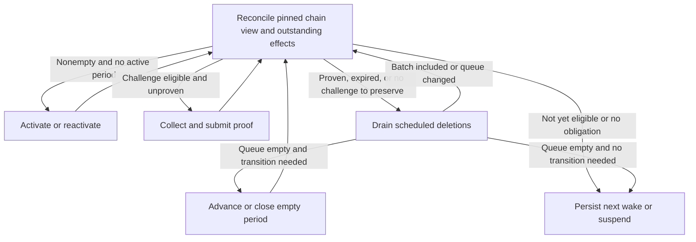

# Client-facing proving and witness assessment

MSP proves its client-facing datasets. Backend SPs prove their own datasets independently and supply piece witnesses to MSP. This design covers the PostgreSQL work records, proof execution, and witness request assessment.

## Ownership and inputs

| Owner | Contract |
| --- | --- |
| Proving | Uses a shared worker pool and leases only due datasets, with at most one owner per dataset. Owns schedule reconciliation, rounds, witness progress, and period actions. SP requests and proof slots have no separate worker queue. |
| Chain access | Provides a coherent chain view and its branch token, canonicality, and historical reads. A read of related verifier/listener state must not mix independently resolved `latest` calls. |
| Client service | Makes managed datasets and lifecycle changes discoverable to Proving. Resolves exact challenged memberships to their admission entries and storage scope, authorizes scheduling client removals, and applies processed deletions using the [deleting-interest contract](storage-model.md#client-piece-deletion). Missing or stale bindings are retryable; never infer access from PieceCID alone. |
| Storage management | Serves current authorized witness sources, including staged sources, for the resolved entry and scope. Owns retention, protection, and alternate placements. |
| Transaction management | Owns nonce allocation, exact signed transactions, broadcast, replacement, and revisable outcomes. Uses the [local transaction APIs](storage-workflows.md#local-transactions-and-module-apis). Treat proof submission and period transitions as deadline-sensitive on the initial one MSP sender per chain. Prioritize before nonce allocation and bound the outstanding ordinary nonce prefix. |
| Provider assessment | Consumes attributed witness failure observations idempotently by attempt ID. Proving can fall back without waiting for assessment. |

## Chain schedule and round identity

Use receipt-first reconciliation, with current-state reads when a receipt is missing, revised, or insufficient. Read dataset liveness, sender and listener, current challenge epoch and range, queued removals, and FWSS deadline, `provenThisPeriod`, configuration, and lifecycle end from one view. Reuse the dataset's applicable activation observation as described below. Relevant source: [PDP getters](https://github.com/FilOzone/pdp/blob/4d6b30f95845ca5ef35f9430a3a3f435af54d291/src/PDPVerifier.sol#L375-L437), [FWSS schedule views](https://github.com/FilOzone/filecoin-services/blob/352b6146723759bd565b8f0d3606541ea792bc83/service_contracts/src/modules/FWSSViewModule.sol#L259-L335), and [FWSS proof validation](https://github.com/FilOzone/filecoin-services/blob/352b6146723759bd565b8f0d3606541ea792bc83/service_contracts/src/modules/FWSSProvingModule.sol#L53-L88). The verifier's last-proven epoch is also initialized by `nextProvingPeriod`; it is not evidence that this FWSS period was proven.

FWSS [sets the activation epoch on first activation and preserves it across reactivation](https://github.com/FilOzone/filecoin-services/blob/352b6146723759bd565b8f0d3606541ea792bc83/service_contracts/src/modules/FWSSProvingModule.sol#L108-L131); [dataset deletion clears it](https://github.com/FilOzone/filecoin-services/blob/352b6146723759bd565b8f0d3606541ea792bc83/service_contracts/src/modules/FWSSDataSetModule.sol#L276-L317). Record a positive epoch once on the dataset with its observation view. For the same live dataset and listener, reuse it when that view is the current view or a known ancestor. The pinned [verifier binds the listener at dataset creation](https://github.com/FilOzone/pdp/blob/4d6b30f95845ca5ef35f9430a3a3f435af54d291/src/PDPVerifier.sol#L682-L697). If there is no applicable observation, read activation from the coherent chain view. Do not cache zero as proof that activation has not happened. After a fork, replace or clear invalidated activation evidence under the branch and worker fences before using it for a new decision.

The effective submission window begins at the later of the scheduled challenge epoch and the FWSS window start. It ends at the earlier of the FWSS proving deadline and any applicable PDP lifecycle end, inclusive in the reviewed contracts ([PDP](https://github.com/FilOzone/pdp/blob/4d6b30f95845ca5ef35f9430a3a3f435af54d291/src/PDPVerifier.sol#L1116-L1124), [FWSS lifecycle guard](https://github.com/FilOzone/filecoin-services/blob/352b6146723759bd565b8f0d3606541ea792bc83/service_contracts/src/lib/LibServiceLifecycleGuards.sol#L9-L15)). Use epochs for chain decisions. Wall-clock projections wake workers and budget latency; they do not establish that a round has missed or that a null epoch has passed.

Start collection when the seed and mapping are available from a coherent chain view. No fixed confirmation wait after the challenge epoch: the verifier uses [epoch beacon randomness](https://github.com/FilOzone/pdp/blob/4d6b30f95845ca5ef35f9430a3a3f435af54d291/src/PDPVerifier.sol#L1234-L1274); modern [Lotus derives it from the signed drand round for that epoch](https://github.com/filecoin-project/lotus/blob/b3be770e0e236f50cc713bbe36c96f08ec3fe779/chain/rand/rand.go#L145-L213). A reorg may leave the seed unchanged while changing the schedule or target mapping. If the view cannot supply that beacon entry yet, wait for a usable chain view, not an arbitrary depth.

Read `challengeRange`, not total dataset leaves. For each required proof index, compute [the verifier's challenge](https://github.com/FilOzone/pdp/blob/4d6b30f95845ca5ef35f9430a3a3f435af54d291/src/PDPVerifier.sol#L1128-L1151): Keccak-256 of the packed seed, dataset ID, and index (32, 32, and 8 bytes respectively), reduced modulo the nonzero range. Resolve indices with [batched `findPieceIds`](https://github.com/FilOzone/pdp/blob/4d6b30f95845ca5ef35f9430a3a3f435af54d291/src/PDPVerifier.sol#L1423-L1436); fetch the expected PieceCID for each distinct piece ID. Read the proof count from the deployed listener configuration, not a compiled-in count. Resolve and verify the matching local membership and authorization scope before publishing a complete plan. On missing bindings, wake on membership application and retry by deadline; do not ask an SP about an unbound target.

Hash an unambiguous encoding of the dataset key, sender, observed listener, FWSS period binding (activation and deadline), effective window, challenge epoch, seed, challenge range, and ordered `(verifier_piece_id, piece_cid, leaf_index, authorization_scope)` targets into `context_key`. Use fixed-width integers and addresses and length-prefixed variable fields. Proving uses the pinned verifier and FWSS rules; there is no per-round ruleset selector. Do not hash the observation view, freshness, wallet balance, or provider choice into the identity. Ordinary head advance must not create a new round. A complete plan is immutable and may be selected again after revalidation. A changed context, including a changed activation epoch, selects a different round; it does not mutate old slots or implicitly copy witnesses across rounds. Takeover of the same context retains already verified needs.

## PostgreSQL records

Illustrative migration, using the [shared SQL domains](storage-model.md#acceptance-records). UUIDs are allocated before insertion. FKs are internal to Proving; opaque IDs across modules use owner APIs. Evolve typed round records through compatible SQL migrations. Version the encoding of action `expected_state` in the payload itself. Enable writes after all workers that can claim the affected datasets can read them.

```sql
CREATE SCHEMA proving;

CREATE TABLE proving.datasets (
    id uuid PRIMARY KEY,
    chain_key text NOT NULL,
    verifier evm_address NOT NULL,
    onchain_dataset_id uint256 NOT NULL,
    activation_epoch bigint CHECK (activation_epoch > 0),
    activation_view bytea,
    checked_branch text,
    active_round_id uuid,
    UNIQUE (chain_key, verifier, onchain_dataset_id),
    CHECK ((activation_epoch IS NULL) = (activation_view IS NULL))
);
CREATE INDEX proving_by_chain ON proving.datasets (chain_key, id);

CREATE TABLE proving.dataset_work (
    dataset_id uuid PRIMARY KEY REFERENCES proving.datasets(id),
    due_at timestamptz,
    lease_until timestamptz,
    generation bigint NOT NULL DEFAULT 0 CHECK (generation >= 0),
    claim_at timestamptz GENERATED ALWAYS AS (coalesce(lease_until, due_at)) STORED
);
CREATE INDEX proving_due ON proving.dataset_work (claim_at, dataset_id)
    WHERE claim_at IS NOT NULL;

CREATE TABLE proving.rounds (
    id uuid PRIMARY KEY,
    dataset_id uuid NOT NULL REFERENCES proving.datasets(id),
    context_key evm_hash NOT NULL,
    origin_view bytea NOT NULL,
    sender evm_address NOT NULL,
    listener evm_address NOT NULL,
    challenge_epoch bigint NOT NULL CHECK (challenge_epoch > 0),
    submit_from_epoch bigint NOT NULL,
    period_deadline_epoch bigint NOT NULL,
    deadline_epoch bigint NOT NULL,
    seed evm_hash NOT NULL,
    challenge_range uint256 NOT NULL CHECK (challenge_range > 0),
    slot_count integer NOT NULL CHECK (slot_count > 0),
    UNIQUE (dataset_id, context_key),
    UNIQUE (dataset_id, id),
    CHECK (challenge_epoch <= submit_from_epoch AND submit_from_epoch <= deadline_epoch
        AND deadline_epoch <= period_deadline_epoch)
);
ALTER TABLE proving.datasets ADD FOREIGN KEY (id, active_round_id)
    REFERENCES proving.rounds (dataset_id, id);

CREATE TABLE proving.witness_needs (
    round_id uuid NOT NULL REFERENCES proving.rounds(id),
    need_index integer NOT NULL CHECK (need_index >= 0),
    authorization_scope uuid NOT NULL,
    piece_cid bytea NOT NULL CHECK (octet_length(piece_cid) > 0),
    leaf_index bigint NOT NULL CHECK (leaf_index >= 0),
    accepted_sp uuid,
    leaf bytea CHECK (octet_length(leaf) = 32),
    siblings bytea CHECK (octet_length(siblings) % 32 = 0),
    PRIMARY KEY (round_id, need_index),
    UNIQUE (round_id, authorization_scope, piece_cid, leaf_index),
    CHECK ((accepted_sp IS NULL AND leaf IS NULL AND siblings IS NULL)
        OR (accepted_sp IS NOT NULL AND leaf IS NOT NULL AND siblings IS NOT NULL))
);
CREATE TABLE proving.round_slots (
    round_id uuid NOT NULL,
    challenge_index integer NOT NULL CHECK (challenge_index >= 0),
    verifier_piece_id uint256 NOT NULL,
    need_index integer NOT NULL,
    PRIMARY KEY (round_id, challenge_index),
    FOREIGN KEY (round_id, need_index) REFERENCES proving.witness_needs (round_id, need_index)
);

CREATE TABLE proving.actions (
    id uuid PRIMARY KEY,
    dataset_id uuid NOT NULL REFERENCES proving.datasets(id),
    round_id uuid,
    kind text NOT NULL CHECK (kind IN ('activate', 'prove', 'process_deletions', 'advance')),
    action_key evm_hash NOT NULL,
    attempt_no integer NOT NULL CHECK (attempt_no > 0),
    expected_state bytea NOT NULL CHECK (octet_length(expected_state) > 0),
    tx_request_id uuid NOT NULL UNIQUE,
    applied_outcome_revision bigint NOT NULL DEFAULT 0 CHECK (applied_outcome_revision >= 0),
    resolved_at timestamptz,
    UNIQUE (dataset_id, action_key, attempt_no),
    FOREIGN KEY (dataset_id, round_id) REFERENCES proving.rounds (dataset_id, id),
    CHECK ((kind = 'prove') = (round_id IS NOT NULL)),
    CHECK (resolved_at IS NULL OR applied_outcome_revision > 0)
);
CREATE UNIQUE INDEX proving_one_pending_action ON proving.actions (dataset_id)
    WHERE resolved_at IS NULL;

CREATE TABLE proving.witness_failures (
    attempt_id uuid PRIMARY KEY,
    round_id uuid NOT NULL REFERENCES proving.rounds(id),
    sp_id uuid NOT NULL,
    authorization_scope uuid NOT NULL,
    piece_cid bytea NOT NULL CHECK (octet_length(piece_cid) > 0),
    failure_code text NOT NULL,
    observed_at timestamptz NOT NULL
);
CREATE INDEX proving_failures_due ON proving.witness_failures (observed_at, attempt_id);
```

`activation_view` identifies the view that established the saved dataset activation. A null epoch and view mean there is no cached activation, not that the dataset is known to be inactive. Publish activation changes under the dataset lock and branch/worker fences. A changed activation does not rewrite historical rounds or the expected state of issued actions.

`origin_view` identifies the planning view in Chain access's encoding; `checked_branch` is the opaque token for the schedule last reconciled. Neither makes a stored round chain-current. A round, its ordered slots and deduplicated needs, and the dataset's active pointer are installed in one transaction. SQL enforces uniqueness and same-round references; the writer checks complete contiguous slots `0..slot_count-1`, correct bindings, and needs referenced by at least one slot. The reader checks completeness before assembly. Siblings are concatenated 32-byte nodes in verifier order. Domain validation checks exact depth, position, and root; SQL byte widths are not witness verification. A need's first accepted witness is immutable and one accepted need can fill several distinct ordered slots.

On takeover, load the saved round, ordered targets, and verified witnesses from PostgreSQL. Revalidate against current evidence before using the plan; do not refetch targets or randomness merely because ownership changed. Read them again when needed to establish applicability or to build a different plan.

`action_key` is a versioned digest of the semantic action: kind, dataset, and expected chain boundary (proof context, activation or advancement period boundary, or deletion phase and observed queue suffix for a drain). `expected_state` retains those preconditions and intended effect in a typed encoding; Transaction management retains the exact call. A fresh attempt for the same purpose after a definitive, reconciled outcome increments `attempt_no` under the dataset lock; it is not a fee replacement. The pending-action index guards the local handoff, not chain canonicality. Revised outcomes for resolved actions can block further issue until reconciled. Retain rounds, signed-call identities, and outcomes while required for reorg or execution recovery. Delete old witness bytes only when no recoverable round or retained execution needs them; keep credentials, witness leaves, and branches out of logs and assessment events.

## Claiming, waking, and fencing

Proving claims the dataset key in `proving.dataset_work` using the [shared wake and lease protocol](execution-and-integrations.md#claims-and-concurrent-wakes). Register this row with the managed dataset. `Proving.MakeDue(tx, datasetKey, due)` updates the work row, not the dataset; later wakes never invent a managed dataset. A future challenge schedules a wake without occupying a worker slot or keeping the lease.

Wake datasets on applied membership or lifecycle changes, revised transaction outcomes, or branch changes. Transaction management publishes outcomes and wakes the dataset in the same transaction without taking the dataset lock. Proving reads applicable outcomes for its actions, including previously resolved actions with revisions it has not applied. Keep each action's evidence; one wake may cover several actions.

On a known fork Proving walks affected chain rows in bounded keyset batches, including dormant datasets with revisable outcomes. If `checked_branch` differs, wake the dataset rather than advancing the token without reconciliation. Restart the sweep after outage or token change. Periodic reconciliation backs up hints; normal head advances do not enumerate every dataset. A stale wake alone cannot reactivate an inactive or terminated dataset.

For chain-dependent writes, take the shared [reconciliation-basis](storage-model.md#execution-and-inclusion-records) lock first, compare the captured branch, then take dataset, action, and Transaction management request locks as needed. Fence on the work row last and roll back if the lease or generation is no longer current. Witness acceptance also requires the captured active round; proof enqueue also requires the current plan and chain evidence. Publish provider observations with the fenced checkpoint. Renew the lease independently of provider or chain I/O. Lost ownership does not count as provider failure; the successor can recollect responses that did not reach a checkpoint.

## Reconciliation and period advancement



An outstanding incompatible action takes precedence over a new action in all branches. Resume from on-chain state, not from a local phase counter. On restart with a scheduled unproven round and enough time, collect for that round even if MSP has no local period-transition receipt. If the current challenge is not yet available, schedule a wake without holding a lease across epochs. Report an MSP deadline miss separately from provider evidence and reconcile the next legal period rather than generating work for historical ones; on-chain fault accounting remains authoritative. A live verifier dataset with no challenge but an active listener deadline may be between deletion batches and advancement. Inspect the queue, listener status and proof disposition before deciding. Do not schedule new proof actions past lifecycle end; use Client service's active obligation/run-off decision, not funding heuristics in Proving.

- **Activate / advance:** `nextProvingPeriod` updates the challenge range and must follow queued deletion processing. Use the [FWSS scheduling rules](https://github.com/FilOzone/filecoin-services/blob/352b6146723759bd565b8f0d3606541ea792bc83/service_contracts/src/modules/FWSSProvingModule.sol#L98-L192) and [verifier requirements](https://github.com/FilOzone/pdp/blob/4d6b30f95845ca5ef35f9430a3a3f435af54d291/src/PDPVerifier.sol#L1254-L1288). On first activation the window is relative to the transaction's inclusion epoch, not its planning epoch. Reactivation is aligned to the existing activation epoch. For normal advancement after proof or expiry, follow the listener's current schedule and skipped-period rules. Choose an early challenge epoch legal across the budgeted inclusion epochs: intersect the allowed listener windows and verifier delay bounds, and leave time after the challenge for proof inclusion. If that intersection is empty or the expected inclusion range changes, do not keep sending the old call. Replan from fresh state after resolving any issued request. Empty inactive datasets need no activation. When the last piece is removed from an active dataset, finish the closing transition when legal; the verifier still requires a legal input epoch even when it ends up clearing the scheduled challenge.
- **Process deletions:** Only after a proof is canonically included, or the active challenge is no longer provable and incompatible submissions are reconciled. A deletion batch clears the challenge. Once the first batch is included, continue draining and advancing on the same safe phase even though `nextChallengeEpoch` is now zero; do not infer a new uninitialized dataset. Select a bounded, gas-fit positive count from `getScheduledRemovals`. [`processPieceDeletions` drains the current tail by count](https://github.com/FilOzone/pdp/blob/4d6b30f95845ca5ef35f9430a3a3f435af54d291/src/PDPVerifier.sol#L1044-L1070), not a list selected by MSP. Recheck the tail before issue. A scheduling transaction can still change the tail before inclusion; correlate and apply only the exact `PiecesRemoved` IDs from the successful receipt. A different valid tail is a result to reconcile, not evidence that the planned IDs were removed. Refresh the queue before dispatching another batch or advancing; a newly queued removal can make an advance revert. Ordinary on-chain advancement does not wait for the [irreversible-action confidence gate](execution-and-integrations.md#chain-confidence-for-irreversible-actions) used for release of backend copies.

Make deletion processing due as soon as the current proof is reconciled or the challenge expires. Drain queued deletions before `nextProvingPeriod`; in steady state, complete both well ahead of the next challenge window. Early dispatch gives time to resolve reverts or fee replacements. It does not prevent replay into the preceding period: after a fork, an escaped deletion can execute on a branch where the proof was orphaned and the old challenge is still valid. The verifier does not check the intended period or proof disposition in `processPieceDeletions`. Whether to require an execution-time guard or accept that residual risk remains a deployment decision.

### Transaction handoff and recovery

1. For a ready proof assemble ordered slots and derive calldata, fee/value and sender from the applicable verifier and fresh chain evidence. In one transaction recheck ownership, branch, outstanding actions and canonical context, insert the action, and call `Transactions.Enqueue` with the exact call and dataset wake key. A crash cannot leave an apparently ready action with no transaction request. If a concurrent effect already satisfies the purpose, reconcile it instead of submitting another call.
2. Before first broadcast, rebroadcast or fee replacement, Transaction management obtains a fresh Proving decision against the exact action: valid, temporarily undecidable, or obsolete. The check performs chain I/O outside locks. It verifies the current period and proof status, ordered targets, effective window and remaining inclusion time for a proof; for a transition it checks the phase, queue and expected inclusion window. A missing RPC result blocks issue/reissue, not receipt tracking. Recheck the request and nonce assignment and persist the exact signed attempt as possibly sent before RPC. There is no separate proving-specific branch fence at send time. A reorg can still race broadcast or replay a transaction already in the network.
3. If an obsolete action never escaped, stop it and resolve its reservation through Transaction management. Do not abandon a lower nonce if later assignments depend on consuming it. If the action may have escaped, stop rebroadcasting its obsolete payload and resolve the assigned nonce by canonical execution, revert, or a confirmed replacement that consumes the same nonce without the obsolete effect. A timeout, cancelled RPC or local lease loss does not free an escaped nonce. Transaction management publishes a revised outcome even for an action stopped before broadcast. Do not dispatch an incompatible transition while the effect is unresolved: verifier entry points do not bind every call to its expected round. Already-issued later nonces cannot be recalled; after a fork reconcile earlier nonce effects and the actual canonical dataset state before granting further issue.
4. Apply the current branch-validated outcome and record its revision on the action atomically. For deletion batches, enqueue the exact effect evidence through Client service's API in that same transaction, keyed by request ID and revision with receipt reference and verifier dataset/piece IDs. Coalescing dataset wakes must not discard evidence for distinct deletion batches. Client service resolves the historical membership binding, revises or retracts invalidated evidence, and owns confidence/release scanning; Proving must not clear storage interests. This enqueue takes no Client admission locks. On a fork reconcile revised outcomes even if the action no longer occupies the pending slot. Preserve the original intent and reconcile the earliest unresolved sender effect; never mark an old proof valid merely because the same nonce or seed reappeared.

`resolved_at` releases the one-new-action slot; it does not mean an outcome can no longer change. If a fork reopens an older effect while a newer action occupies that slot, leave the old row closed for new issue. Reconcile its revised outcome through the same transaction request and hold any incompatible send until the older effect is resolved. A consumed lower nonce is not evidence that a proof succeeded.

If a fork orphans a proof, resume collection or submission only if the current challenge is still open and the current context permits it. If a replayed `processPieceDeletions` cleared that challenge, do not resend the old proof or try to recreate the old challenge. Report the round as unproven, apply only the actual canonical deletion outcome, and reconcile the earliest legal `nextProvingPeriod`. The [copy-release gate](storage-model.md#client-piece-deletion) still applies. Exercise both reorg paths in deployment verification.

## Witness collection and assessment

For missing needs, resolve authorized sources from Storage management and order candidates using readiness, retention, and provider evidence. Include the Upload SP's protected staged source when it is the only usable copy. A staged witness can satisfy a challenge, not the [committed-copy requirement during deletion](storage-model.md#client-piece-deletion). Do not treat an existing unopened or outgoing placement as evidence of continuing coverage.

Batch within the round by SP, authorization scope, and PieceCID, with distinct leaf indices. Use the [Curio witness HTTP contract](../proposals/curio-inclusion-proof-proposal.md) for credentials, limits, verification and errors. Do not persist bearer credentials or share results across authorization scopes. Apply the response to the exact request. Validate the full response's shape and every branch before accepting a batch; a malformed/invalid batch yields no accepted witnesses. Publish accepted needs in short fenced transactions as batches finish. Assembly is by challenge index, not SP response order. When refreshing or taking over, only re-request missing needs from still usable routes; no SP-side work ID or callback is required for this read-only API.

Use bounded worker capacity reserved for proving, bounded request/body/verification work, and process-wide limits for requests overall and per SP, not one unbounded goroutine per need. Size per-process limits for the deployed replica count; SP quotas remain authoritative across instances, including when an old owner's HTTP requests linger after failover. Take the earliest proof cutoff first among locally runnable requests. Reserve collection failover time and a separate chain submission reserve for preflight, registry/chain lookups, signing, the existing nonce prefix, replacement, and inclusion. Stop new collection attempts at the proof's collection cutoff. A request must leave room for a healthy fallback if one exists; prefer fallback on timeout or explicit failure and allow a bounded hedge only when waiting would consume that room. Cancel redundant requests after success. If no candidate is ready, promptly refresh source evidence and schedule a bounded retry before cutoff. No automatic cutoff or retry moves the on-chain deadline.

Each attempted request has a transient attempt ID. Checkpoint attributable outcomes such as an invalid witness, provider timeout, or `witness_not_ready` with provider, scope, piece and observation time. Keep evidence even when fallback succeeds. A quota response is capacity evidence, not proof of lost data. Local saturation, owner loss, cancelled hedges, bad local credentials and a missed chain deadline are not provider failures. A bounded dispatcher transfers committed failures idempotently to Provider assessment and deletes their inbox entries only in the same local transaction that records delivery. Neither per-attempt HTTP issue nor every unobserved outcome needs durable tracking; taking over may repeat a read for a missing need. One round's provider failure is evidence for assessment, not authorization to remove data or to mark an entire SP unavailable.

## Budgets and verification gates

The per-dataset lease is the initial work unit. For a round with $S$ slots and $U$ distinct needs, persist $S$ bindings and at most $U$ verified witnesses; per healthy source, request count is the sum of bounded batches per `(SP, scope, PieceCID)`. Use bulk inputs/outputs for mappings and checkpoints; do not perform a database or chain round trip per proof slot. Account for heartbeat/index churn per **leased** dataset, not per witness. Derive scan rate and concurrency from peak simultaneously due datasets, SP capacity, and measured alternate-source latency. For failover require lease expiry + discovery + acquisition + reload/revalidation + remaining collection + submission reserve to fit the original window. Measure rather than fixing numeric lease, backoff, and concurrency defaults here.

| Scenario | Required observation |
| --- | --- |
| Two claimers, concurrent wake, or owner loss mid-request | Different live claims, no lost wake, stale owner writes rejected, successor keeps committed witnesses and the original deadline. |
| Duplicate slots, slow provider, corrupt branch, or quota response | Exact ordered calldata, bounded fan-out, sufficient fallback time, preserved attributable evidence. |
| First proof before backend AddPieces | An authorized parked Upload SP supplies verified witnesses, including for a large piece after cache restart, before the original cutoff. |
| Restart after activation, reactivation, or a fork that orphans first activation | A still-applicable activation observation is reused across rounds and reactivation. An invalidated observation cannot select a round or authorize a transition on the new branch. |
| Null epoch or reorg with unchanged drand seed | Wait for usable chain inputs; reject an obsolete mapping before issue and reconcile an escaped nonce before incompatible work. |
| Crash after enqueue or broadcast; proof receipt invalidated | Durable request and signed identity recover; same-nonce replacement does not duplicate logical work; revised outcome can reopen schedule reconciliation. |
| Deletion tail changes, removal batches cross a restart, or deletion receipt reorgs | Only actual receipt IDs update their exact interests. Next period does not wait for the backend release gate, but copies stay protected when removal evidence is stale. |
| Ordinary transactions occupy low nonces during a proof burst | Admission/backpressure preserves the measured submission reserve for proving; if one sender cannot meet it, reassess sender allocation before increasing witness fan-out. |

Deployment gates: pin the verifier/listener versions and chain RPCs, exercise first activation and reactivation around inclusion/window boundaries, validate chain view and nonce-resolution behavior under reorg, and measure the Curio staging and fallback path.
