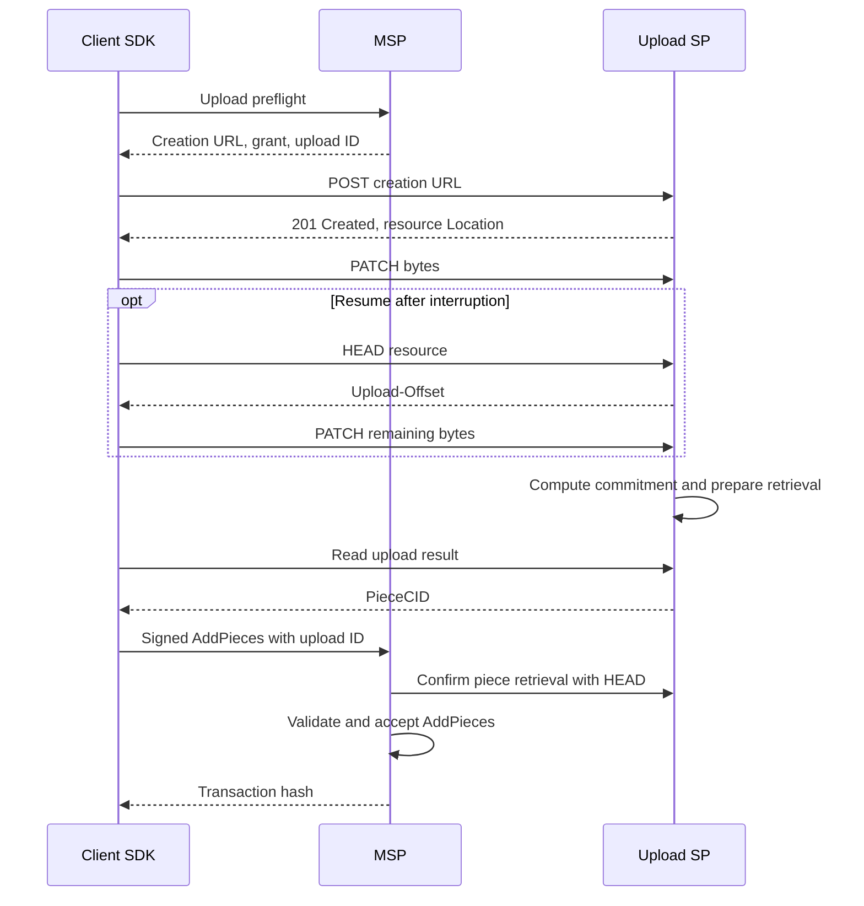

# Direct tus uploads with MSP preflight

Status: proposal

## Purpose

Provide resumable uploads directly to a storage provider while keeping upload authorization and provider selection with the MSP.

The MSP coordinates storage across providers. The client SDK uploads a piece to an Upload SP, then submits a signed AddPieces request to the MSP to register it for storage. A PieceCID identifies the piece by its commitment (CommP) and raw size. The PieceCID may be unknown until the upload finishes.

This design covers upload authorization, transfer, and preparation for AddPieces. It does not change storage pricing, replication policy, or on-chain admission semantics.

## Design

The SDK first requests upload authorization from the MSP. The MSP selects an Upload SP and returns its tus creation endpoint with a scoped grant. The SDK creates and uploads the resource directly at that provider using tus 1.0.0.

The MSP does not allocate the provider resource or carry upload bytes. This keeps provider-side allocation out of preflight recovery and lets the SDK use standard tus Creation.

## Upload contract

### MSP preflight

`POST /uploads/preflight` authenticates the client and accepts an optional expected PieceCID. When supplied, its encoded raw size determines the upload length. Otherwise, the client may provide an expected raw size or leave it unknown.

The MSP checks staging limits, selects a provider, and persists an upload record before returning:

| Field | Meaning |
| --- | --- |
| `uploadId` | Stable MSP correlation ID |
| `creationUrl` | Selected provider's absolute tus creation URL |
| `uploadGrant` | Credential authorizing creation at that provider |
| `maxSize` | Maximum permitted raw byte count |
| `creationExpiresAt` | Deadline for creating the resource |

The grant binds the upload ID, client, provider, size limit, optional expected PieceCID, and expiry. A known size is enforced exactly. Repeating preflight with the same client-scoped idempotency key and parameters returns the same upload identity; different parameters conflict.

The upload grant is an MSP-signed JWT, sent as an Authorization bearer token and verified locally by the provider using the MSP's public keys. Claims include issuer, provider audience, expiry, upload ID, and the upload constraints above. Use asymmetric signing so providers cannot issue grants. The upload ID, not the token ID, remains the creation idempotency key across credential renewal.

Preflight authorizes staging only. It does not reserve funds or accept a storage obligation.

### Resource creation and transfer

The SDK sends an empty POST to `creationUrl` with the grant, `Tus-Resumable: 1.0.0`, and `Upload-Length`. The provider returns `201 Created` with the resource URL in `Location`.

Unknown-length uploads use `Upload-Defer-Length: 1` and require the provider's `creation-defer-length` extension. The SDK sets `Upload-Length` in a PATCH once the final length is known. The provider enforces the grant's maximum throughout transfer.

Transfer uses standard tus PATCH requests. After an interrupted or uncertain request, the SDK obtains the accepted offset through HEAD and resumes from there. The provider must persist bytes and offset before acknowledging them.

The SDK retains the complete resource URL, including any deployment prefix. It forwards credentials only to authorized provider origins. HEAD, PATCH, and result lookup require authorization; credential renewal preserves the resource identity and does not extend its retention deadline.

Resumption requires replayable input. A consumed stream cannot resume after client process loss unless its bytes were spooled or can be regenerated.

### Creation idempotency

Tus Creation does not define idempotency. This design requires a provider extension: one resource per MSP upload ID.

The provider atomically records the resource and its grant binding before responding. Repeated or concurrent creation with equivalent parameters returns the same resource URL without resetting its offset. Different parameters conflict. An expired or deleted resource cannot be recreated under the old grant; the provider retains that binding through the supported recovery window.

### Piece processing

Completing the tus transfer schedules durable provider-side processing. The provider computes CommP and raw size from the accepted bytes, checks any expected PieceCID, and publishes the piece for retrieval. Commitment calculation must survive restart, either through consistent checkpoints or recomputation from staged bytes.

A separate result endpoint reports `receiving`, `processing`, `parked`, `failed`, or `expired`. A parked result contains the upload ID, PieceCID, and staging retention deadline; raw size is read from the PieceCID. Processing failures retain a reason.

The provider advertises the result URL in an application-specific link on creation and resource HEAD responses. Result reads are repeatable; completing processing does not consume the upload identity. No client finalize POST is required.

## AddPieces handoff

The SDK signs the resulting PieceCID in AddPieces and supplies the upload ID alongside the signed payload. The MSP resolves the source through its own upload record, not a client-supplied retrieval URL.

Before accepting the request, the MSP requires HTTP 200 from the selected provider's configured piece retrieval HEAD endpoint, with Content-Length matching the raw size encoded in the signed PieceCID. It also simulates the exact intended contract call to check authorization and funding.

Tus completion establishes byte receipt only. A parked result establishes readiness for the MSP's source check. Neither is storage acceptance. The SDK reports storage success only after successful client-facing AddPieces inclusion on chain; backend replication proceeds separately.

Upload retries do not create new AddPieces authorizations. Existing accepted-request replay semantics remain unchanged.

## Deployment requirements

Providers must trust MSP-issued grants and expose HTTPS upload and retrieval endpoints. Browser clients require CORS support on the upload and result endpoints.

Credential expiry, unfinished-upload expiry, and parked-piece retention are separate deadlines. Retention must cover processing and admission recovery. Polling does not renew it. Once the MSP accepts AddPieces, upload expiry or source loss does not cancel its storage obligation.

Creation With Upload, parallel partial uploads, provider migration during transfer, and already-present-content deduplication are outside this proposal.

## Validation

Before deployment, verify:

- Lost preflight or creation responses and concurrent creation recover one upload resource.
- Interrupted transfers and provider restarts preserve the accepted prefix and produce the correct PieceCID.
- Size violations and commitment mismatches fail processing; expired grants cannot authorize new allocation.
- Piece processing survives a lost final PATCH response; refreshed credentials recover the same resource and result.
- Uploads preserve resource URLs with deployment prefixes.
- Unreadable pieces fail admission, and storage success remains tied to AddPieces inclusion.

## Protocol reference

[tus resumable upload protocol 1.0.0](https://tus.io/protocols/resumable-upload), including Creation, deferred length, and expiration. MSP grants, creation idempotency, and piece-result lookup are application contracts, not tus protocol features.
